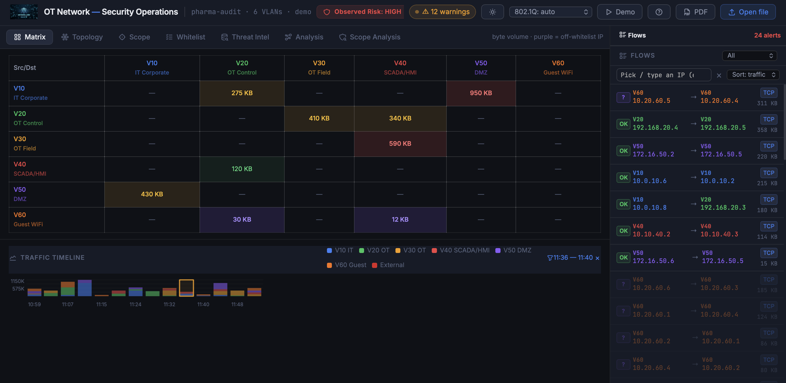
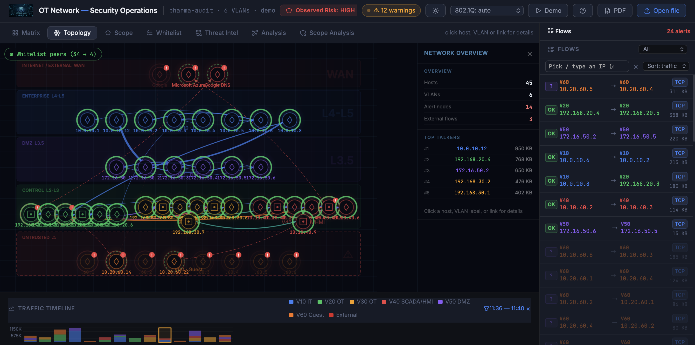
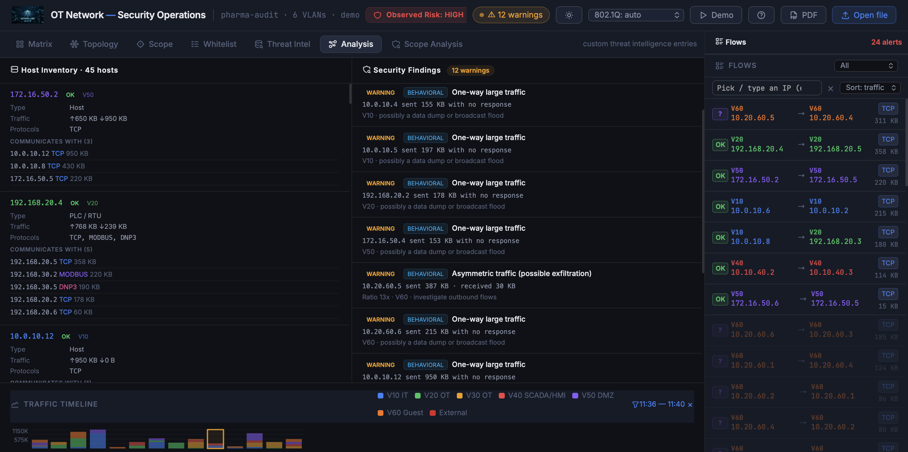
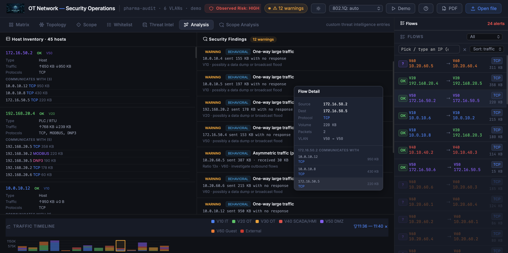

# OT Dashboard — Industrial Network Security & Analytics

A standalone, browser-based tool for OT/ICS network traffic analysis.  
**No installation. No backend. No internet connection required.**

> Open the HTML file in your browser. Drag & drop a pcap. Get instant visibility into your industrial network.

---

## Interface Overview

### Traffic Matrix & Timeline

The **Matrix** tab gives you a VLAN-to-VLAN communication heatmap at a glance — colored by volume, with the traffic timeline below for temporal analysis.

- Each cell shows the total byte volume exchanged between two network segments
- Color intensity reflects traffic volume
- The **Traffic Timeline** at the bottom shows stacked traffic by VLAN over time — select a time window to zoom in
- The **Flows** panel on the right lists individual connections with protocol tags and volume

---

### Network Topology

The **Topology** tab renders an interactive graph of all hosts, grouped by network zone (WAN, Enterprise, DMZ, Control, Untrusted).

- Hosts are automatically grouped by VLAN/zone
- Red indicators flag hosts with anomalies
- Click any host or link for detailed flow information
- The **Network Overview** panel shows top talkers, alert counts, and external flow count
- External connections (Microsoft Azure, Google DNS…) appear in the WAN zone

---

### Host Inventory & Security Findings

The **Analysis** tab combines the full host inventory with security findings side by side.

**Host Inventory (left panel):**
- IP address, VLAN membership, device type (Host / PLC / RTU / HMI…)
- Traffic volume (upload / download)
- Protocol list per host
- Full list of peers with volume per connection

**Security Findings (right panel):**
- Behavioral anomalies: one-way traffic, asymmetric flows, broadcast storms
- OT-specific alerts: Modbus write operations, S7 program downloads, new hosts
- Each finding includes the source IP, VLAN, volume, and a plain-text explanation

---

### Flow Detail

Click any flow in the right panel to open the **Flow Detail** popup — source, destination, protocol, volume, packet count, and VLAN path.

---

## Supported Formats

| Format | Notes |
|--------|-------|
| `.pcap` | Standard libpcap |
| `.pcapng` | Enhanced capture format |
| Multiple files | Merged into a unified view |

Name your files with VLAN hints for automatic segment detection:  
`vlan20_OT.pcap`, `V30_field.pcapng`

---

## OT Protocol Deep Parsing

| Protocol | Details |
|----------|---------|
| **Modbus TCP** | Function codes, read/write operations |
| **EtherNet/IP / CIP** | Vendor, model, revision, serial via identity object |
| **PROFINET** | Device detection |
| **DNP3** | Function code analysis |
| **S7 (Siemens)** | Download, upload, PLC Stop, Write Var detection |
| **MELSEC** | Mitsubishi Electric fingerprinting |

---

## Anomaly Detection

- Unusual protocols in OT zones (HTTP, DNS, RDP…)
- Cleartext protocols: Telnet, FTP, HTTP
- OT device mixing OT and IT protocols
- Port scans and broadcast storms
- S7 program upload/download sequences
- New hosts appearing on the network
- Asymmetric traffic (possible exfiltration)
- One-way large traffic (possible data dump)

---

## How to Use

1. Open `ot_dashboard.html` in your browser (Chrome recommended)
2. Drag & drop one or more `.pcap` / `.pcapng` files, or click **Open file**
3. Navigate through the tabs: **Matrix → Topology → Scope → Whitelist → Threat Intel → Analysis → Scope Analysis**
4. Use the **Flows** panel on the right to drill down into individual connections
5. Export your findings as a **PDF report** with one click

> All processing happens locally in your browser. No data leaves your machine.

---

## Requirements

- Modern browser (Chrome or Edge recommended)
- No installation, no dependencies, no server

---

## License

GNU General Public License v3.0 — see [LICENSE](LICENSE)

Free to use, share and modify. Any derivative work must remain open source under the same terms.

---

## Author

**Christophe Prince** — Senior OT/ICS Penetration Tester  
[github.com/christopheprince](https://github.com/christopheprince) · [LinkedIn](https://www.linkedin.com/in/christophe-prince-a08528403)
